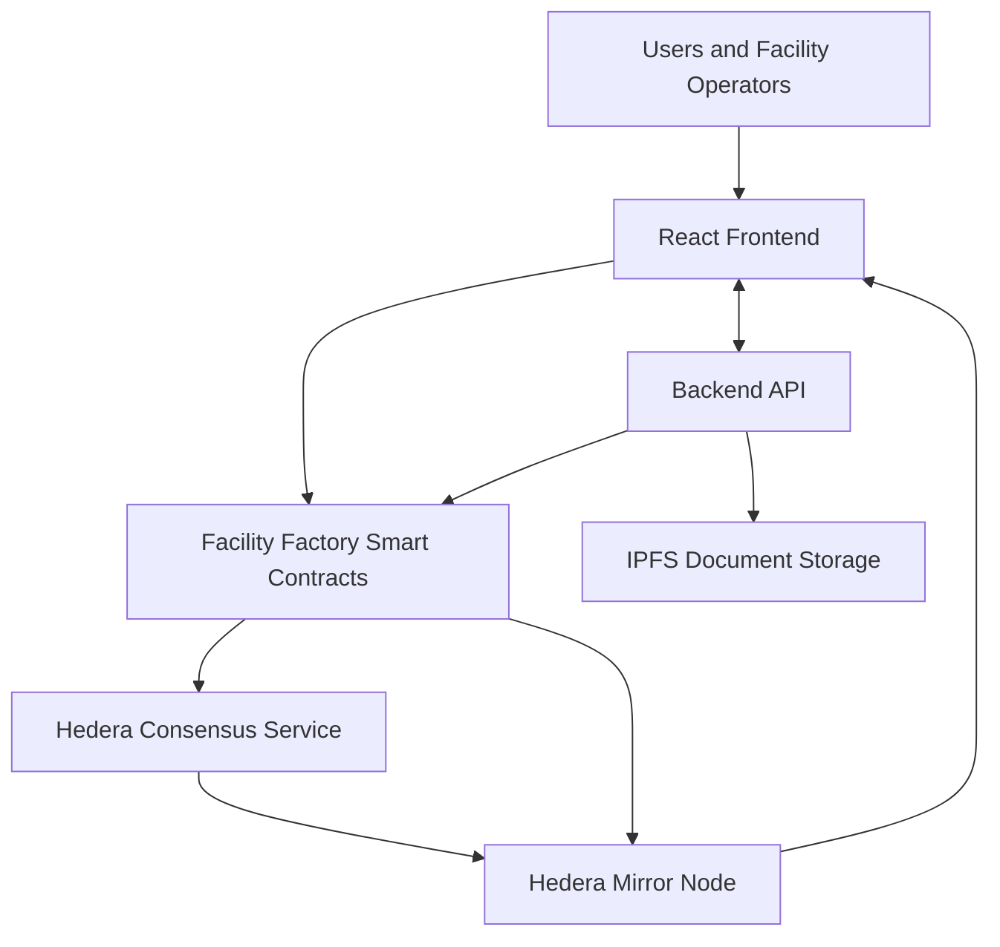
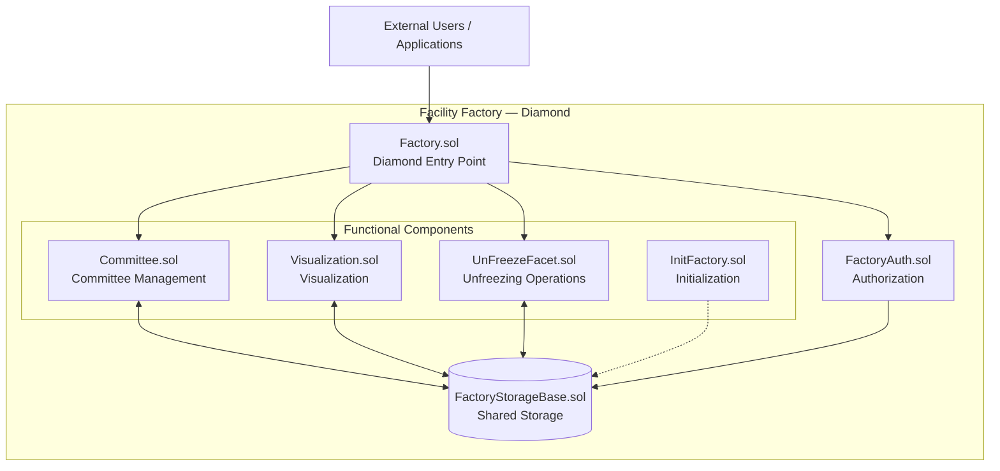
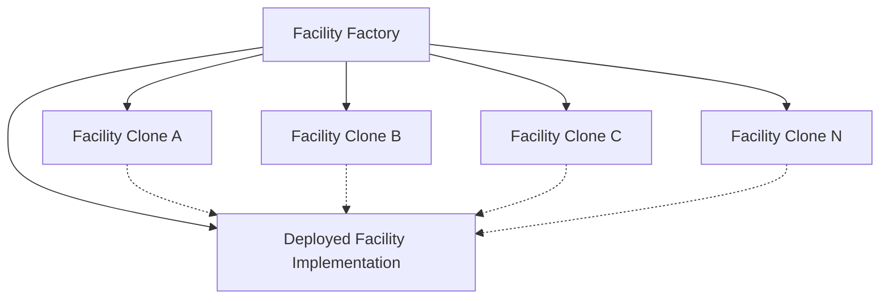
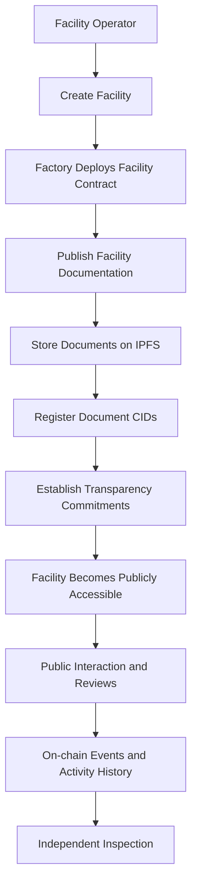

# VeriFactory

**A decentralized facility transparency and accountability ecosystem built on Hedera.**

Facility Factory is a platform designed to make the commitments, documentation, and public interactions of infrastructure facilities independently verifiable.

The platform allows facilities to be deployed through a factory architecture, publish signed documentation, establish verifiable transparency commitments, and expose their activity through Hedera's public infrastructure.

Rather than relying exclusively on information supplied by facility operators, Facility Factory introduces an on-chain layer of accountability where important commitments and interactions can be independently inspected.

---

## 1. The Idea

Infrastructure facilities operate in environments where transparency, accountability, and public trust are essential.

Whether dealing with energy production, aerospace infrastructure, desalination plants, or data centers, stakeholders need more than promises: they need verifiable evidence of what a facility commits to disclose and how it interacts with its surrounding ecosystem.

Facility Factory approaches this problem through three fundamental concepts:

- **Verifiable commitments:** Facilities publish documentation and establish transparency commitments that can be inspected independently.
- **Decentralized accountability:** Important interactions and events are recorded through Hedera, providing an independently accessible history.
- **Public participation:** External participants can interact with facilities, submit reviews, and contribute to the transparency ecosystem.

The central idea is simple:

**A facility should not be the sole authority responsible for proving its own transparency.**

Facility Factory provides the infrastructure through which its commitments and interactions become independently verifiable.

## 2. System Architecture

The platform is composed of several interconnected components, each responsible for a specific part of the system.



### Frontend

The frontend provides the interaction layer for users and facility operators.

It exposes facility information, documentation, transparency commitments, reviews, and relevant blockchain activity.

The repository contains dedicated frontend components for facilities as well as the main application frontend.

### Backend

The backend coordinates application-level operations and data retrieval (for scalability purposes)

It provides the interface between the application and its supporting services, including facility-related interactions and review management.

### Smart Contracts

The smart contract infrastructure is designed around two primary objectives: **modularity and cost-efficient deployment**.

#### 1. Diamond Architecture — Modular Factory

The factory follows a Diamond-inspired architecture, separating its functionality into independently maintainable components (facets).

Instead of implementing every operation inside one monolithic contract, the system distributes responsibilities across specialized components while maintaining shared storage.



The architecture separates responsibilities while allowing the factory to maintain a coherent state.

This design has an important engineering advantage: **correcting mistakes and extending functionality can be significantly less expensive than replacing an entire monolithic contract.**

When a particular component requires modification, the architecture provides a modular boundary for addressing that functionality instead of requiring a complete factory redeployment.

#### 2. Minimal-Cost Facility Instantiation — Clones

Beyond the factory itself, Facility Factory uses the clone pattern to instantiate individual facilities.

Rather than deploying a complete copy of the facility implementation every time a new facility is created, the system reuses a deployed implementation through lightweight contract clones.

Each clone maintains its own independent storage and facility state while delegating execution to the shared implementation.



This approach dramatically reduces deployment overhead.

A conventional independent facility deployment could cost approximately **100 HBAR**, whereas clone-based instantiation brings the deployment cost down to approximately **2–5 HBAR at most**, depending on network conditions and transaction costs.

<ins>That represents a substantial reduction in the cost of expanding the ecosystem.</ins>

The result is an architecture where:

- The factory remains modular and maintainable.
- Facility instances retain independent state.
- New facilities can be instantiated at a fraction of the conventional deployment cost.
- Fixes and improvements can be targeted at the relevant implementation components.

**The underlying philosophy is to make the ecosystem inexpensive to expand and inexpensive to maintain.**

### IPFS

IPFS is used for storing facility documentation.

Documents are represented through content identifiers (CIDs), allowing their contents to be retrieved and independently verified against their corresponding identifiers.

The platform maintains references to published documentation rather than relying on a centralized database as the sole source of truth.

### Hedera Consensus Service

HCS provides a decentralized event-recording layer.

Relevant system interactions can be published as consensus messages, creating an externally accessible record of activity.

### Hedera Mirror Node

The Mirror Node provides an interface for retrieving and inspecting historical Hedera network activity.

It allows the application to expose blockchain events and transaction history without requiring users to operate their own network nodes.

---

## 3. Facility Lifecycle

The following diagram illustrates the high-level lifecycle of a facility.



### Facility deployment

Facility operators interact with the factory to create independent facility instances.

Each facility has its own contract identity and associated state.

### Documentation and commitments

Facilities can publish documentation in PDF format.

The associated document identifiers are registered in the system, allowing published documentation to be retrieved and checked against its content identifier.

The platform also records the transparency level promised by each facility, making its declared commitments visible to external participants.

### Public interaction

Once deployed, facilities become accessible through the application.

Users can inspect their published information, interact with the platform, and submit reviews.

These interactions contribute to the facility's publicly observable activity.

---

## 4. Documentation Integrity and Decentralized History

One of the fundamental architectural decisions behind Facility Factory is the separation of document storage from the decentralized record of document references and system activity.

IPFS handles document content, while Hedera provides the public ledger infrastructure.

This separation allows the platform to combine content-addressed storage with independently inspectable network activity.

The architecture includes:

- Content identifiers associated with published documents.
- Facility-specific document references.
- Signed facility documentation.
- Hedera transactions and consensus messages.
- Historical activity retrieval through the Mirror Node.

This design avoids treating a conventional application database as the ultimate authority for every important piece of facility information.

---

## 5. Testnet Population and Data Generation

Facility Factory includes dedicated scripts and simulation components for populating and exercising the Hedera testnet environment.

The objective is to demonstrate the system under activity generated by multiple independent accounts rather than relying exclusively on manually created demonstration records.

The population infrastructure includes:

- Creation of multiple Hedera testnet wallets.
- Funding of generated accounts.
- Automated interactions with deployed contracts.
- Simulated facility ecosystem activity.
- Generation of transactions and associated network history.

The simulation layer allows the project to demonstrate how the ecosystem behaves when multiple participants interact with its facilities.

### Testnet activity

**More than 50 independently created and funded wallets** have been prepared to populate the testnet environment and generate activity.

These accounts provide the foundation for demonstrating multi-participant interactions across the platform.


> <span style="color:red">**[!CAUTION] IMPORTANT — LIVE DEMONSTRATION DATA**</span>
>
> <span style="color:red">The live demonstration does NOT rely on mock data or hardcoded demonstration records to represent blockchain activity. The displayed ecosystem activity is generated through simulated interactions performed by more than 50 real, independently created and funded Hedera testnet wallets.</span>
>
> <span style="color:red">These are simulated participants and interactions, but the underlying accounts, funding, transactions, and resulting testnet activity are real network activity.</span>

This distinction is important: the interactions are simulated, but the underlying blockchain activity is not fabricated.

---

## 6. Repository Structure

```text
factory_facility/
│
├── backend/
│   └── Backend services and application logic
│
├── contracts_deployment/
│   └── Smart contract deployment infrastructure
│
├── contracts_pdf/
│   └── Facility documentation and PDF contracts
│
├── DataGeneration/
│   └── Testnet account creation, funding and population scripts
│
├── frontends_for_facilities/
│   └── Facility-specific frontend components
│
├── hashgraph/
│   └── Hedera and Hashgraph integration
│
├── Simulation/
│   └── Ecosystem simulation and automated interactions
│
├── vite_frontend/
│   └── Main frontend application
│
├── docker-compose.yml
├── technical_report.md
└── README.md
```

---

## 7. Technology Stack

The project brings together decentralized infrastructure, application development, document storage, and automated simulation.

| Component | Technology |
|---|---|
| Blockchain infrastructure | Hedera |
| Smart contracts | Solidity |
| Consensus and event history | Hedera Consensus Service |
| Historical network data | Hedera Mirror Node |
| Document storage | IPFS |
| Frontend | React, TypeScript, Vite |
| Containerization | Docker, Docker Compose |
| Automated testnet population | Dedicated project scripts |

---

## 8. Design Philosophy

Facility Factory is built around a distinction between application convenience and decentralized verifiability.

A conventional backend can coordinate application operations and provide an efficient user experience. However, important facility commitments and relevant decentralized activity should not depend exclusively on the continued availability or integrity of that backend.

By combining independently deployed facility contracts, content-addressed documentation, consensus-backed events, and public network history, Facility Factory aims to provide a more transparent foundation for infrastructure accountability.

**The objective is not simply to put facility information on a blockchain. It is to build an ecosystem where commitments, documentation, and interactions can be independently examined.**

---

## 9. Getting Started

The repository includes a Docker Compose configuration and an example environment file.

```bash
git clone https://github.com/JO-00/VeriFactory
cd VeriFactory
```

Configure the environment:

```bash
chmod +x entrypoint.sh
./entrypoint.sh
```

open
`http://localhost:5173`

For additional technical specifications, see [`technical_report.md`](./technical_report.md).

---

## 10. Network

Facility Factory currently operates on the Hedera testnet.

All blockchain interactions in the live demonstration should be understood in the context of a testnet environment, rather than production deployment.

