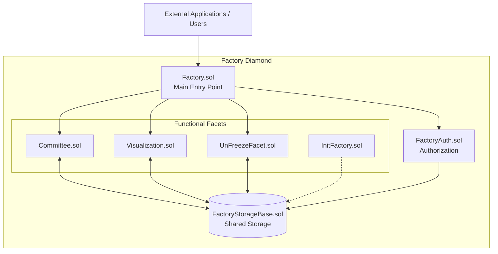
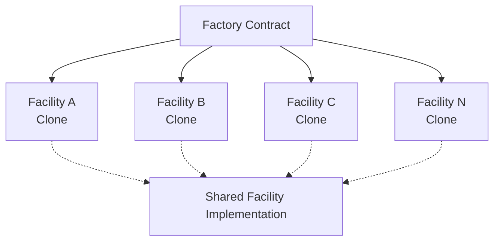

# Technical Architecture and Protocol Logic

This section examines the internal implementation of VeriFactory, focusing on smart contract architecture, facility lifecycle, operational permissions, contractual commitments, decentralized governance, and the interaction between independent actors.

## 1. Smart Contract Architecture

The smart contract infrastructure is built around two architectural decisions: modularity and inexpensive facility instantiation.

### 1.1 Diamond Architecture — Factory Modularity

The factory follows a Diamond-inspired architecture, separating functionality into specialized facets while maintaining shared storage.

Instead of concentrating every operation inside one monolithic contract, responsibilities are distributed across independent components.



The primary motivation behind this architecture is maintainability.

When a component requires correction or modification, its functionality can be addressed independently rather than requiring the entire factory to be replaced.

This reduces the scope of maintenance operations and provides a modular foundation for extending the protocol.

### 1.2 Facility Instantiation — Minimal Proxy Clones

Facilities are instantiated through lightweight clones of a previously deployed implementation.

Without clones, every facility creation would require deploying the complete facility bytecode again, resulting in substantial and repetitive deployment costs.

With the clone pattern, the implementation is deployed once and reused by subsequent facility instances.



Each clone maintains independent storage and facility state while executing the shared implementation logic.

This significantly reduces deployment overhead:

| Deployment approach | Approximate cost |
|---|---:|
| Independent facility deployment | ~100 HBAR |
| Clone-based instantiation | 2–5 HBAR |

The reduction makes it economically practical to instantiate numerous independent facilities without repeatedly paying for deployment of the entire implementation.

### 1.3 Facility Lifecycle and Exit Semantics

Each facility is represented by a distinct contract instance.

Leaving the platform does not destroy the deployed contract or erase its historical state. Instead, the facility is removed from the platform's active registry.

An existing facility contract cannot simply be registered again.

Consequently, rejoining the platform requires deploying a new facility instance.

This distinction preserves the historical existence of previously registered facilities while preventing an exited instance from being reintroduced as a new active participant.

## 2. Facility Operational Architecture

### 2.1 Infrastructure Hierarchy

Each facility is initialized with a tree-like structure containing exactly two levels beneath the facility:

```text
Facility
├── Relayer 1
│   ├── Gateway 1
│   ├── Gateway 3
│   └── Gateway 4
├── Relayer 2
│   ├── Gateway 2
│   └── Gateway 4
└── Relayer 3
    ├── Gateway 3
    └── Gateway 5
```

The facility owner is responsible for assigning gateways to relayers and revoking those assignments.

Gateway key rotation and gateway banning are restricted to authorized relayers and the facility administrator.

| Actor | Permissions |
|---|---|
| Facility Owner | Assign and revoke gateways |
| Facility Administrator | Rotate gateway keys and ban compromised gateways |
| Relayer | Rotate keys of managed gateways |
| Gateway | Publish measurements and associated cryptographic evidence |

### 2.2 Gateway Cadence Policies

Each gateway is associated with a measurement cadence policy:

```solidity
struct CadencePolicy {
    uint256 expectedInterval;
    uint256 gracePeriod;
}
```

- `expectedInterval`: Expected maximum duration between consecutive measurements.
- `gracePeriod`: Additional tolerance before a missing measurement is classified as overdue.

For example, a gateway configured with an expected interval of 60 seconds and a grace period of 30 seconds is considered overdue after 90 seconds without a new measurement.

### 2.3 Emergency Override

Facilities can declare emergencies through `EnableEmergencyOverride()`.

While the emergency override is active, gateway key rotations are prevented.

This establishes an explicit operational constraint on key-management operations during declared emergency situations.

## 3. Contractual Commitments

The protocol uses six predefined contractual documents: five intended for facilities and one intended for inspectors.

Each document is stored on IPFS and identified by its Content Identifier (CID).

### 3.1 Facility Agreements

| Agreement | IPFS CID |
|---|---|
| Measurement Disclosure Agreement | [`bafkrei…tdji`](https://ipfs.io/ipfs/bafkreib4z6m55m7h43baf6vrpre6wbobmmkv4joqgvwou22dui6sdbtdji) |
| Gateway Key Management Agreement | [`bafkrei…egcy`](https://ipfs.io/ipfs/bafkreiebyahgas7fcbkn5l5btbyy4diegstg6vymn7rkdoqwkljvywegcy) |
| Facility Inspection and Cooperation Agreement | [`bafkrei…c6e`](https://ipfs.io/ipfs/bafkreiazoh3pzxb7xkpfpahx2homftykipjwsnyxy6fojlixycwxmexc6e) |
| Incident Disclosure Agreement | [`bafkrei…mpj4`](https://ipfs.io/ipfs/bafkreieh2xx3cvhg7wdntzifj53tzgdhdommsgogasbsrvuwaj272ompj4) |
| Assessment Disclosure Agreement | [`bafkrei…dzhy`](https://ipfs.io/ipfs/bafkreidglsdrujbietvdp4hjxcsecwn7rxfidlm5f7l42uyudiapeadzhy) |

### 3.2 Inspector Agreement

Inspectors must sign the Inspector Independence and Conduct Agreement before participating in the inspection process.

IPFS CID: [`bafkrei…xqf4`](https://ipfs.io/ipfs/bafkreih6vihdkwrurh4h5lksitxzqgn4stpxqadxujxkulfppilmw3xqf4)

The inspector's signature is saved on-chain, establishing an independently traceable contractual commitment.

### 3.3 Commitment Persistence

Facility agreements are not ordinary application preferences that can be selectively withdrawn.

A facility cannot undo an individual signed agreement while remaining an active participant in the platform.

Leaving the platform is the exit mechanism. The deployed facility contract and its historical commitments remain intact.

Rejoining requires a new facility deployment and a new contractual participation process.

This creates a distinction between leaving the active ecosystem and erasing previously established commitments.

## 4. DAO Governance and Inspector Selection

### 4.1 DAO Composition

The platform maintains a global DAO composed of members contributed by participating facilities.

Each facility can stake a maximum of three members.

The contribution schedule is:

| Membership position | Contribution |
|---|---:|
| First member | 0.25 HBAR |
| Second member | 1 HBAR |
| Third member | 1 HBAR |

The maximum contribution per facility is therefore 2.25 HBAR.

Removing a member triggers a refund corresponding to that member's contribution.

### 4.2 Committee Selection

Every four weeks, a new committee is selected from the global DAO.

The committee contains at most five members.

The selection process is handled by the smart contract infrastructure.

### 4.3 Inspector Candidate Registration

Inspectors register as candidates after signing the Inspector Independence and Conduct Agreement.

Their signatures are stored on-chain, allowing the governance process to consider candidates who have already accepted the applicable contractual obligations.

### 4.4 Ranked Voting

Each committee member submits an ordered ranking of up to five preferred inspector candidates.

The voting system uses a positional scoring mechanism:

| Candidate position | Points |
|---|---:|
| 1st | 5 |
| 2nd | 4 |
| 3rd | 3 |
| 4th | 2 |
| 5th | 1 |

For example, a ranking of `[Alice, Bob, Charlie, Don, Elon]` assigns five points to Alice and one point to Elon.

The accumulated scores determine candidate preferences across the committee.

### 4.5 Vote Finalization

Voting is frozen when one of three conditions is satisfied:

1. All five committee members have voted.
2. Four members have voted and the remaining vote cannot change the outcome.
3. At least three members have voted and two days have elapsed.

Once frozen, the voting results become immutable for that committee cycle.

### 4.6 Inspector Assignment

Following vote finalization, inspectors are assigned to facilities using a round-robin distribution mechanism.

The intended assignment structure provides:

- One inspector per facility.
- Multiple facilities per inspector when the number of facilities exceeds the number of available inspectors.

This distributes inspection responsibilities across the selected candidates rather than allowing arbitrary assignment to individual facilities.

### 4.7 Inspector Accountability

Inspector selection does not grant unrestricted authority.

Every inspector must first accept the Inspector Independence and Conduct Agreement.

This establishes contractual obligations on the inspection side, complementing the transparency and cooperation obligations imposed on facilities.

The protocol therefore establishes accountability for both parties involved in the inspection process.

## 5. Decentralized Event Architecture

Each facility has its own Hedera Consensus Service topic.

The topics provide independent event streams associated with individual facilities.

| Event | Description |
|---|---|
| `measurement.recorded` | Publishes facility measurements from IoT gateways |
| `gateway.key_rotated` | Records gateway public-key rotations |
| `emergency.declared` | Records the declaration of a facility emergency |
| `maintenance.started` | Records the beginning of maintenance operations |
| `maintenance.completed` | Records maintenance completion |
| `inspection.submitted` | Records inspector report submissions |

Different actors have different publishing responsibilities and are expected to interact only with the topics and event types relevant to their roles.

This separation provides a structured event history that can subsequently be inspected by the application and other authorized participants.

## 6. Independent Execution Environments

The system uses four categories of Dockerized actors.

| Container | Primary responsibility |
|---|---|
| FacilityOwner | Facility initialization, contractual registration, infrastructure management, emergency declarations and gateway administration |
| Gateway | Periodic measurement generation, IPFS publication and HCS message submission with associated signatures |
| Relayer | Gateway key rotation for managed infrastructure |
| Inspector | Blockchain event monitoring, facility assignment detection and inspection report generation |

Each actor operates independently within its own execution environment.

This separation allows the protocol to simulate an ecosystem of interacting participants instead of relying on one centralized process to perform every operation.

### 6.1 FacilityOwner

After creating a facility contract, the owner initializes its infrastructure and registers the required contractual commitments.

The owner also manages gateway-relayer assignments and can perform the authorized administrative operations associated with the facility.

### 6.2 Gateway

Gateways periodically generate measurements and publish their content to IPFS.

The resulting CID, accompanied by its cryptographic signature, is subsequently submitted to the facility's HCS topic.

This separates measurement content storage from its decentralized event publication.

### 6.3 Relayer

Relayers manage the gateways assigned to them.

Their responsibilities include performing authorized gateway key rotations and maintaining the operational key-management lifecycle.

### 6.4 Inspector

Inspectors monitor relevant blockchain events, including committee finalization and inspection assignments.

After identifying the facilities assigned to them, they retrieve the relevant information, perform their inspections and generate reports.

Their submissions are subsequently represented through the corresponding facility event stream.

## 7. Application-Level Verification

The frontend is expected to derive important facility information from the deployed contracts and their associated event histories.

In particular, it should:

- Detect which agreements a facility has signed.
- Retrieve and inspect the corresponding document references.
- Monitor facility-specific HCS messages.
- Identify contradictions between declared commitments and observed activity.
- Expose relevant historical events to users.

This allows the application to do more than display information supplied by facility operators: it can compare declared contractual commitments against independently observable activity.